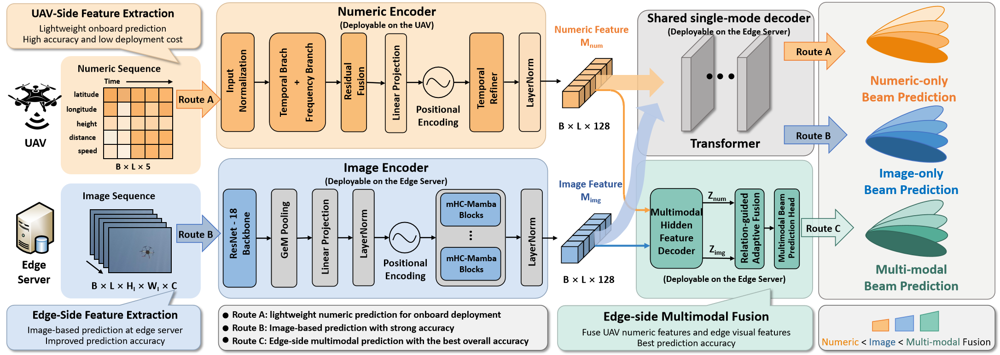

# Multimodal Data-Driven Multi-Step Beam Prediction

Proposed multimodal beam prediction models for UAV-to-ground mmWave communications in low-altitude networks. This repository contains the model implementation and inference runner. The large prepared test tensors and inference checkpoints are distributed separately through the download links below.

The proposed system supports three prediction routes:

- **UAV-side numeric route**: GPS, height, distance and speed sequences.
- **Edge-side image route**: RGB image sequences.
- **Edge multimodal route**: hidden-state fusion of the numeric and image routes.

Each future time step is a 64-class beam-index classification problem. Two released protocols are supported: **10 input steps -> 5 predicted steps** and **5 input steps -> 2 predicted steps**.



## Repository Layout

```text
.
├── README.md                         # Project overview and inference guide
├── requirements.txt                  # Python dependencies
├── .gitattributes                    # Git LFS rules for large tensors/checkpoints
├── assets/
│   └── proposed_framework_overview.png
├── code/
│   ├── model.py                      # Shared model for both protocols
│   ├── model_components.py           # Shared encoder/fusion components
│   ├── inference.py                  # Protocol-aware model construction/loading
│   ├── checkpoint_utils.py           # Checkpoint loading helpers
│   ├── uav_side_numeric_beam_prediction.py
│   ├── edge_side_image_beam_prediction.py
│   └── edge_multimodal_fusion.py     # Route-specific 10-to-5 compatibility APIs
├── dataset/
│   ├── README.md                     # Dataset download link and file layout
│   ├── 10to5/                        # Downloaded prepared 10-to-5 tensors
│   └── 5to2/                         # Downloaded prepared 5-to-2 tensors
├── weights/
│   ├── README.md                     # Checkpoint download link and file layout
│   ├── 10to5/                        # Downloaded 10-to-5 checkpoints/config
│   └── 5to2/                         # Downloaded 5-to-2 checkpoints/config
└── eval/
    ├── infer.py                      # Command-line inference and metrics
    ├── README.md                     # Evaluator options
    └── reference_results.json        # Verified release metrics
```

## Task Protocols

| Protocol | Numeric input | RGB input | Output logits | Prepared test samples |
|---|---|---|---|---:|
| 10-to-5 | `[B, 10, 5]` | `[B, 10, 3, 128, 128]` | `[B, 5, 64]` | 2,275 |
| 5-to-2 | `[B, 5, 5]` | `[B, 5, 3, 224, 224]` | `[B, 2, 64]` | 323 |

The five numeric channels are GPS longitude/latitude, height, distance and speed as prepared by the released tensors. RGB tensors are stored as `float16` and converted to `float32` by the evaluator. Do not resize, normalize or otherwise transform the released tensors before inference.

## Model Overview

### Numeric encoder

`NumericEncoder` uses the Overlap MixLinear encoder in `model_components.py`. It combines overlapping local temporal patches, a short-window auxiliary branch and a low-rank frequency branch, followed by temporal refinement and projection to the shared hidden dimension.

### Image encoder

`VisionEncoder` uses ResNet18 with GeM pooling, a learned projection and HMC-Mamba residual temporal layers. The backbone is initialized with `weights=None` because the complete inference weights are supplied in the released checkpoint.

### Decoder and multimodal fusion

The numeric-only and image-only routes use the shared zero-query Transformer decoder. The multimodal route generates prediction-step hidden states for both modalities, combines relation terms (`image - numeric` and `image * numeric`) with adaptive anchoring, and applies the lightweight step-mixing prediction head.

The same `model.py` and `model_components.py` are used for both protocols. Sequence length, prediction length, numeric window sizes and decoder settings are read from the matching `weights/<protocol>/model_config.json`.

## Download Large Files

The large files are not stored in the source repository. Download them from the following Quark Cloud links and preserve the directory layout described in the linked README files:

- **Prepared dataset tensors**: [Quark Cloud dataset download](https://pan.quark.cn/s/d981b19a886d)
- **Inference model weights**: [Quark Cloud model-weight download](https://pan.quark.cn/s/09fc39e19bfc)

After downloading, the repository should contain:

```text
dataset/
├── 10to5/
│   ├── inputs.pt
│   ├── rgb.pt
│   └── metadata.json
└── 5to2/
    ├── inputs.pt
    ├── rgb.pt
    └── metadata.json

weights/
├── 10to5/
│   ├── model_config.json
│   ├── uav_side_numeric_beam_prediction_ckpt.pth
│   ├── edge_side_image_beam_prediction_ckpt.pth
│   └── edge_multimodal_beam_prediction_ckpt.pth
└── 5to2/
    ├── model_config.json
    ├── uav_side_numeric_beam_prediction_ckpt.pth
    ├── edge_side_image_beam_prediction_ckpt.pth
    └── edge_multimodal_beam_prediction_ckpt.pth
```

The `.pt` and `.pth` files are inference artifacts, not encrypted files. They contain the prepared tensors, images, labels where provided, or model state dictionaries needed for inference. See [dataset/README.md](dataset/README.md) and [weights/README.md](weights/README.md) for exact download and placement instructions.

## Installation

Use Python 3.10 or newer. A CUDA-capable PyTorch installation is recommended for image and multimodal inference. Install dependencies with:

```bash
pip install -r requirements.txt
```

Install a PyTorch/torchvision build compatible with your CUDA version, then install a compatible `mamba-ssm` build. Inference does not download ImageNet weights or access the original project directory.

## Running Inference

Run commands from this repository root after downloading both the dataset and weight packages.

### Evaluate all three routes

```bash
python eval/infer.py --protocol 10to5 --mode all
python eval/infer.py --protocol 5to2 --mode all
```

### Evaluate one route

```bash
python eval/infer.py --protocol 10to5 --mode numeric
python eval/infer.py --protocol 10to5 --mode image
python eval/infer.py --protocol 5to2 --mode multi
```

Valid modes are `numeric`, `image`, `multi` and `all`. The default device is `cuda`; use `--device cpu` when a CUDA/Mamba environment is unavailable:

```bash
python eval/infer.py --protocol 5to2 --mode numeric --device cpu
```

### Quick smoke inference

Use `--limit` to test only the first few prepared samples. This is a smoke test and does not reproduce the full-dataset metrics.

```bash
python eval/infer.py --protocol 5to2 --mode multi --limit 8
```

### Optional JSON metrics

The default runner prints metrics and does not create prediction files. To save one JSON metrics file per route, provide an output directory:

```bash
python eval/infer.py --protocol 10to5 --mode all --output-dir results/10to5
```

The evaluator reports sample count, loss, Top-1/Top-2/Top-3/Top-5 accuracy and the first sample's Top-5 beam IDs at each future step. It intentionally does not save large prediction tensors.

### Python API

```python
import sys
import torch

sys.path.insert(0, "code")
from inference import build_predictor

device = "cuda" if torch.cuda.is_available() else "cpu"
model = build_predictor(protocol="5to2", mode="multi", device=device)

# Prepared tensors; do not apply another resize or normalization.
numeric = torch.randn(2, 5, 5, device=device)
image = torch.randn(2, 5, 3, 224, 224, device=device)
with torch.inference_mode():
    logits = model(numeric=numeric, image=image, mode="multi")
print(logits.shape)  # torch.Size([2, 2, 64])
```

For real inference, load numeric and RGB tensors from `dataset/<protocol>/inputs.pt` and `dataset/<protocol>/rgb.pt`; the example tensors above only illustrate the interface and are not meaningful model inputs.

## Verified Release Results

The following results were obtained by running the supplied checkpoints on the full prepared test inputs. Full-precision records are in `eval/reference_results.json`.

| Protocol | Route | Top-1 | Top-2 | Top-3 | Top-5 |
|---|---|---:|---:|---:|---:|
| 10-to-5 | Numeric | 0.8376 | 0.9706 | 0.9887 | 0.9961 |
| 10-to-5 | Image | 0.9470 | 0.9879 | 0.9945 | 0.9980 |
| 10-to-5 | Multimodal | 0.9766 | 0.9962 | 0.9982 | 0.9994 |
| 5-to-2 | Numeric | 0.4923 | 0.6610 | 0.7632 | 0.8715 |
| 5-to-2 | Image | 0.5619 | 0.7585 | 0.8545 | 0.9272 |
| 5-to-2 | Multimodal | 0.5635 | 0.7926 | 0.8824 | 0.9381 |

The 10-to-5 multimodal row uses the historical batch-mean aggregation.
